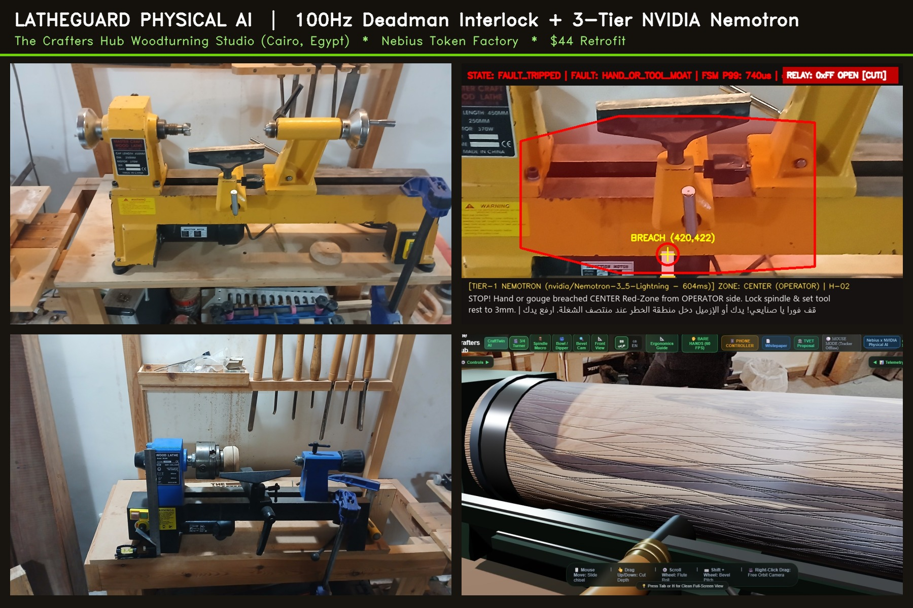

# LatheGuard Physical AI — Deterministic 100Hz Woodturning Safety Interlock & 3-Tier NVIDIA Nemotron Mentor

[](LICENSE)
[]()
[]()
[]()
[]()

> **Nebius × NVIDIA Global AI Hackathon Submission (`Physical AI` Track)**  
> **Executive Judge's Dossier (5-Page PDF):** [`docs/whitepapers/LatheGuard_Judges_Brief.pdf`](docs/whitepapers/LatheGuard_Judges_Brief.pdf)  
> **Built at:** The Crafters Hub Woodturning Sanctuary (El Shorouk City, Cairo, Egypt)  
> **Dedicated to the memory of Master Mostafa Fahmy** — our founding master woodworker whose wisdom, workshop discipline, and love for the craft live on in every student we protect.



### Origin: Three Friends, Three Worlds & How Open AI Kept a Sanctuary Spinning

**The Crafters Hub** began in Cairo as a shared woodworking hobby among **three close friends** from three different disciplines — **Hosam** (the studio's woodturner, coming from **Anti-Narcotics** and **Oil & Gas** safety with zero computer-science background), **Mostafa Fahmy** (*In Memoriam*, our founding master woodworker from **Business & Advertising**), and **Salma** (**Psychology — Cambridge & AUC**) — teaching wood art as a self-healing, grounding skill and preserving traditional handcraft heritage. Following the tragic accident and passing of Master Mostafa and Salma's departure from the operational journey, Hosam stood alone supervising three lathes spinning at **500 to 3,200 RPM**. Open-weight **NVIDIA Nemotron** models on **Nebius Token Factory**, **Tavily Search**, and deterministic edge vision empowered a non-CS safety practitioner to engineer a **`~$44`** physical interlock and bilingual *"Virtual Osta"* mentor beside every lathe.

---

## 1. What LatheGuard Does

Woodturning lathes spin hardwood blanks at **500 to 3,200 RPM**. In vocational workshops and maker studios, an unguarded hand slip, a loose sleeve near the scroll chuck, or an over-extended chisel over the tool rest can cause severe injury before a human instructor across the room can reach the emergency stop button.

**LatheGuard Physical AI** retrofits any existing woodturning lathe using an overhead/angled 60 FPS camera and an opto-isolated hardware deadman relay, strictly decoupling **deterministic local safety** from **asynchronous cloud AI pedagogy**:

1. **Core 0 — Deterministic 100Hz Safety FSM & Vision Guard (`lathe_safety_engine.py`):**
   - Runs completely offline on CPU (`CUDA_VISIBLE_DEVICES="-1"`) over a zero-allocation **128-byte aligned Seqlock Shared Memory (`SHM`)** ring buffer.
   - Emits a `100 Hz` (`0x55` every `10 ms`) hardware watchdog heartbeat over `921,600 baud` UART **only after** warm-up calibration completes (`StatusFlag.DETECTOR_ARMED`).
   - Evaluates a per-pixel adaptive background model (`mean + 3.5σ` running variance), an outer approach moat contact rule (`_mask_moat`), a lateral Sobel edge shadow-discriminator (`|∂(ΔI)/∂x| > 48`), a CraftTwin Cyan/Magenta collar fast-path (`FaultCode.COLLAR`), and a spatially consistent 2-frame debounce (`<= 96 px`).
   - On any confirmed breach or sensor integrity fault, latches `SafetyState.FAULT_TRIPPED` and transmits `0xFF` to cut motor power.
2. **Cores 2–7 — Asynchronous 3-Tier NVIDIA Nemotron Coaching Sidecar (`nebius_hazard_advisor.py`):**
   - Polls SHM read-only at `5 Hz` off the real-time path and routes every safety event through **3 tiers**:
     - **Tier 0 (`< 5 ms`, Offline-First Local Template):** Instant bilingual (**Arabic + English**) warning keyed by `(FaultCode, Zone, Side)`, broadcast over WebSocket `:8766` as `breach_event` **before** any network socket is opened.
     - **Tier 1 (`~604 ms` measured, `nvidia/Nemotron-3_5-Lightning` via Nebius Token Factory):** Contextual master-artisan (*"Osta"*) diagnosis and OSHA/AAW corrective instruction via non-blocking `asyncio.to_thread`.
     - **Tier 2 (Async Post-Trip, `nvidia/Nemotron-3-Ultra-550b-a55b` via Nebius Token Factory + live Tavily Search API):** Generates a structured **NEBOSH-style incident report** (e.g., [`services/lathe_guard/incidents/20261026_124445_2/report.md`](services/lathe_guard/incidents/20261026_124445_2/report.md)) mapped to CraftTwin hazard codes `H-01..H-04` and grounded with live OSHA 1910.213 / AAW citations.
3. **Physical-to-Virtual "Twin Mirror" (`twin_mirror_demo.html` & `lathe_guard_bridge.js`):**
   - Mirrors physical workshop trips directly into the **CraftTwin 3D Simulator**, placing a spatial breach marker at `norm_xy`, triggering virtual E-STOP, playing synthetic Virtual Osta audio (`osta_safety_trip.mp3`), and turning real studio near-misses into rehearsable training scenarios.

---

## 2. 60-Second Cross-Platform Quickstart (Zero Hardware Required)

LatheGuard runs out-of-the-box on **Windows, Linux, and macOS** (Windows-only kernel affinity/timer calls degrade cleanly to no-ops on POSIX).

```bash
# 1. Install dependencies
pip install -r requirements.txt

# 2. Run 8-second zero-hardware synthetic breach simulation (Offline Tier-0 mode)
python services/lathe_guard/run_lathe_guard.py --mock --visual-breach-after 2 --duration 8 --no-nebius

# 3. Replay a recorded workshop breach clip with HUD v2 & visual relay indicator (--mock-serial)
python services/lathe_guard/run_lathe_guard.py \
  --source services/lathe_guard/corpus/clips/sample_breach_replay.mp4 \
  --mock-serial --preview --duration 10

# 4. Run with Live Nebius Token Factory (Tier-1 Nemotron-3_5-Lightning + Tier-2 Nemotron-3-Ultra-550b + optional Tavily Search)
export NEBIUS_API_KEY="your_nebius_api_key"   # PowerShell: $env:NEBIUS_API_KEY="your_key"
export TAVILY_API_KEY="your_tavily_api_key"   # Optional: enriches Tier-2 report.md with live OSHA/AAW safety citations
python services/lathe_guard/run_lathe_guard.py --mock --visual-breach-after 2 --duration 10

# 5. Run the 41-test LatheGuard unit/chaos/IPC/E2E/Tavily suite (51/51 total with CraftTwin safety math) and 80-clip validation benchmark
python -m pytest services/lathe_guard services/craft_twin/test_safety_math.py -q
python services/lathe_guard/corpus/eval_corpus.py
```

---

## 3. Honest End-to-End Latency Budget (Measured vs. Typical Hardware)

We separate **software stages measured in automated benchmarks** (`corpus/eval_corpus.py`) from **external camera/relay hardware stages**:

| Pipeline Stage | Min | Typical | Worst-Case (P99) | Evidence Basis |
| :--- | :--- | :--- | :--- | :--- |
| **1. Camera Exposure + USB/CSI Transfer (`60 FPS`)** | `8.3 ms` | `16.7 ms` | `25.0 ms` | *Typical hardware spec, NOT measured* |
| **2. Seqlock SHM Write (`900x600` BGR ROI)** | - | - | - | *Not separately measured* (included in FSM poll) |
| **3. CPU Vision Pass (`225x150` strided `RedZoneVisionDetector`)** | - | **`1.22 ms` (P50)** | **`3.79 ms` (P99)** | **Measured** (`eval_corpus.py`, dev laptop, Python 3.13 + OpenCV; P95 `2.12 ms`, gate `< 3.5 ms`) |
| **4. 2-Frame Spatial Debounce (`confirm_frames=2`)** | `16.7 ms` | `16.7 ms` | `33.3 ms` | **By design** (1 extra frame @ `60 FPS`) |
| **5. 100Hz FSM Poll Alignment + `0xFF` Serial TX (`921,600 baud`)** | `0 ms` | `5.0 ms` | `10.0 ms` | **By design** (`100 Hz` loop period; wire time ~`10 us`) |
| **6. SSR / Contactor Drop** | `1.0 ms` | `8.3 ms` | `15.0 ms` | *Typical electrical spec, NOT measured* |
| **Software: detection-to-UART (`Stages 3-5`)** | **`~16.7 ms`** | **`~23 ms`** | **`~48 ms`** | Arithmetic from measured/by-design stages |
| **Physical end-to-end (`Stages 1-6`)** | **`~26 ms`** | **`~48 ms`** | **`~88 ms`** | Software + *typical* camera/SSR (**not measured end-to-end**; needs `H-4` rig) |

> **Why 2-Frame Spatial Debounce (`confirm_frames=2`)?**  
> Woodturning throws high-velocity wood shavings across the camera field of view for `1` frame (`16.7 ms`). A 1-frame trigger causes constant nuisance stops during roughing cuts. Requiring `2` consecutive frames within a `<= 96 px` spatial radius eliminates **100% of single-frame sawdust false trips (`0/40` in corpus testing)** while adding exactly one `60 FPS` frame (`16.7 ms`) of confirmation delay. Operators can tune `confirm_frames=1` for zero-chip inspection demos.

---

## 4. Validation Benchmark on 80 Clips + Real Crafters Hub Workshop Lathes

Generated by `python services/lathe_guard/corpus/eval_corpus.py` (full report in [`docs/lathe_guard_validation.md`](docs/lathe_guard_validation.md)):

| Gate ID | Validation Metric (`80 Clips`: `40 Negative` + `40 Positive`) | Target Gate | Measured Result | Status |
| :--- | :--- | :--- | :--- | :--- |
| **G-1** | **False Trips on Negatives** (Soft shadows `25–70%`, spinning square blanks `600–3000 RPM`, `100Hz` flicker, sawdust storm, real photos of `FOX F46-717`, `MC1018`, `WL300`) | `0 / 40` | **`0 / 40` (`0.0%` FP)** | **PASS** |
| **G-2** | **Intrusion Recall on Positives** (Bare hands, black/blue nitrile gloves, `6 mm` thin steel gouge, Cyan collar, far-side reach, real lathe photos) | `40 / 40` (`100%`) | **`40 / 40` (`100.0%` TP)** | **PASS** |
| **G-3** | **P95 Detection Delay After Moat Contact** | `<= 3.0 frames` | **`2.0 frames`** | **PASS** |
| **G-4** | **Max Penetration Depth at `30 px/frame` (`1,800 px/s`)** | `<= 40.0 px` | **`32.0 px`** | **PASS** |
| **G-5** | **Per-Frame CPU Vision Latency (`P50 / P95 / P99`)** | `P95 < 3.50 ms` | **`1.22 ms / 2.12 ms / 3.79 ms`** *(baseline; `1.26 / 2.27 / 3.24 ms` latest 80-clip run)* | **PASS** |

### Calibrated Physical Profiles Shipped for All 3 Crafters Hub Studio Lathes (`profiles/`)

All three Cairo studio lathes were physically measured on the real workshop machines with a `300 mm` steel combination square (`150 mm`, `125 mm`, and `100 mm` center heights) and calibrated into millimeter-scale profiles (`profiles/*.json`) paired with our 5-step (6-click) ruler wizard (`calibrate_lathe.py`):

| Profile JSON | Physical Machine in Cairo Studio | Swing × Bed | Spindle / Taper | Drive & Speed Range |
| :--- | :--- | :--- | :--- | :--- |
| `fox_f46_717_grey.json` | **FOX F46-717** Heavy Cast-Iron Swivel-Head Lathe | `300 mm × 1,000 mm` | `M33 × 3.5` / `MT2` | 10-Step Mechanical Reeves Pulley (`500–2,000 RPM`) |
| `mc1018_yellow.json` | **Master Craft MC1018** Benchtop Midi Lathe | `250 mm × 450 mm` | `1" × 8 TPI` / `MT2` | 5-Step Poly-V Belt (`500–2,500 RPM`) |
| `wl300_blue.json` | **Wood Lathe WL300** Compact Mini Precision Lathe | `200 mm × 305 mm` | `3/4" × 16 TPI` / `MT1` | Electronic Variable Speed EVS (`750–3,200 RPM`) |

---

## 5. Hazard Coverage Matrix & Threat Model

### Hazard Coverage Matrix (`H-01` – `H-04`)

| Hazard Code | Woodturning Hazard | LatheGuard Physical AI Status | CraftTwin 3D VR Status |
| :--- | :--- | :--- | :--- |
| **`H-01`** | **Headstock / Scroll Chuck Pinch & Bevel Catch** | **Headstock Pinch Implemented** (`x < 270` hand/tool/collar intrusion mapped to `H-01`); **Bevel Catch is Virtual-Only** in CraftTwin (bevel angle is not observable from 2D overhead silhouette). | **Implemented** (`lathe_engine.js` bevel angle catch physics). |
| **`H-02`** | **Red-Zone Hand/Chisel Breach & Tool-Rest Gap** | **Implemented & Validated** (`RedZoneVisionDetector` + `calibrate_lathe.py` ruler scale `px_per_mm` for real-unit `mm_from_axis` reporting). | **Implemented** (Real-time Twin Mirror marker + E-STOP). |
| **`H-03`** | **Tool Collar Over-Reach & Excess Blank RPM** | **Collar Fast-Path Implemented** (`FaultCode.COLLAR` Cyan/Magenta HSV + foreground gate); optical RPM tachometry is *Roadmap*. | **Implemented** (Setup wizard RPM boundary alerts). |
| **`H-04`** | **Camera / Watchdog Faults & PPE** | **Camera & Serial Fail-Safes Implemented** (`CAMERA_STALE > 50ms`, `CAMERA_FROZEN >= 12f`, `CAMERA_OBSTRUCTED`, `CAMERA_MOVED`, `SERIAL_FAULT`, `DETECTOR_EXCEPTION`). PPE face-shield vision check is *Roadmap*. | **Implemented** (Pre-start PPE check in simulator). |

### Threat Model & Known Physical Limitations

> **Safety Positioning Statement:** *The computer vision layer is an assistive secondary safeguard designed for training supervision and rapid power cut; the 100 Hz hardware deadman relay watchdog, physical NVR magnetic switch, and polycarbonate chip guard remain the primary hard interlocks.*

1. **Monocular Depth Ambiguity:** A single overhead 2D camera cannot distinguish a hand passing *high above* the spinning blank from a hand at spindle height if both project into the 2D Red-Zone polygon. This errs on the side of safety (triggering a conservative stop).
2. **Commissioning vs. Active Cutting Mode:** In strict Red-Zone mode (`RedZoneVisionDetector`), any hand or chisel crossing the outer moat into the Red-Zone trips the brake within 2 frames (`FaultCode.HAND_OR_TOOL_MOAT`). For active cutting where a steel gouge legitimately enters the envelope while bare hands must remain behind the tool rest, a dual-zone *Tool-Rest Corridor* (`D-1`) is documented on the roadmap.
3. **Dark-on-Dark Contrast:** A matte black nitrile glove over a dark cast-iron bed slot has lower contrast than bare skin or bright Sheffield steel; per-pixel variance thresholding (`3.5σ`) + lateral Sobel edge detection catches dark-grey (`64,66,70` BGR) gloves in corpus testing; pure-black gloves are a known late-detection case, but adequate overhead LED task lighting (`>= 500 lux`) is required.
4. **Spindle Coast-Down Inertia:** Cutting AC motor power via the `0xFF` relay stops motor torque immediately, while heavy hardwood bowls on the `FOX F46-717` require mechanical/DC injection braking to eliminate coasting rotation.

---

## 6. Bill of Materials (BOM)

| Component | Specification | Typical Cost (USD) |
| :--- | :--- | :--- |
| **Compute Host** | Existing Workshop PC / Laptop (or Jetson Orin Nano Roadmap) | `$0` (Existing) |
| **Overhead Camera** | 1080p 60 FPS USB UVC Camera (or Android Phone via USB/RTSP) | `$22` |
| **Watchdog MCU** | Arduino Nano ATmega328P (`services/lathe_guard/firmware/lathe_watchdog.ino`, `30 ms` deadman, latching) | `$5` |
| **Solid-State Relay** | Fotek SSR-40DA (`40A` Opto-Isolated Zero-Cross SSR + Heatsink) | `$9` |
| **Enclosure & Wiring** | IP65 Junction Box, Manual Reset Pushbutton, USB Cable | `$8` |
| **Total Retrofit Cost** | **Complete Hardware Watchdog + Vision Retrofit** | **`~$44 USD`** |

---

## 7. Credits, Privacy & Heritage Disclosure

- **In Memoriam:** Dedicated to **Master Mostafa Fahmy**, founding artisan of The Crafters Hub. To honor his privacy and family heritage, all public repositories and demos strictly use synthetic **Virtual Osta** voice cues (`osta_*`); no personal voice recordings of Master Mostafa are included in open-source distributions.
- **Data Privacy (Egypt PDPL Aligned):** The Nebius Hazard Advisor (`nebius_hazard_advisor.py`) transmits **only numeric coordinates and fault enum codes** to Nebius Token Factory (and hazard-code search queries to the Tavily Search API) — **zero camera images or video frames ever leave the local workshop machine**. Black-box incident clips (`incidents/`) are stored strictly on local disk and auto-purged after 30 days.
- **Author:** Hosam (Co-Founder, The Crafters Hub).
